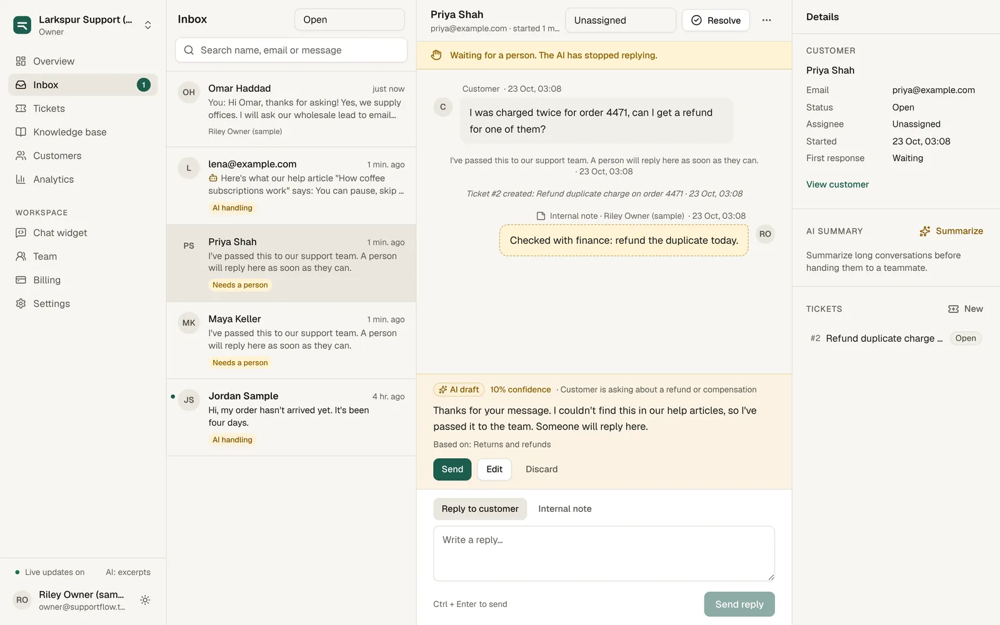
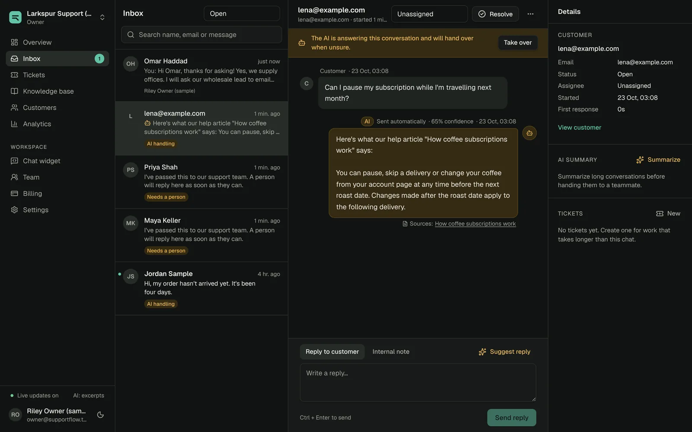
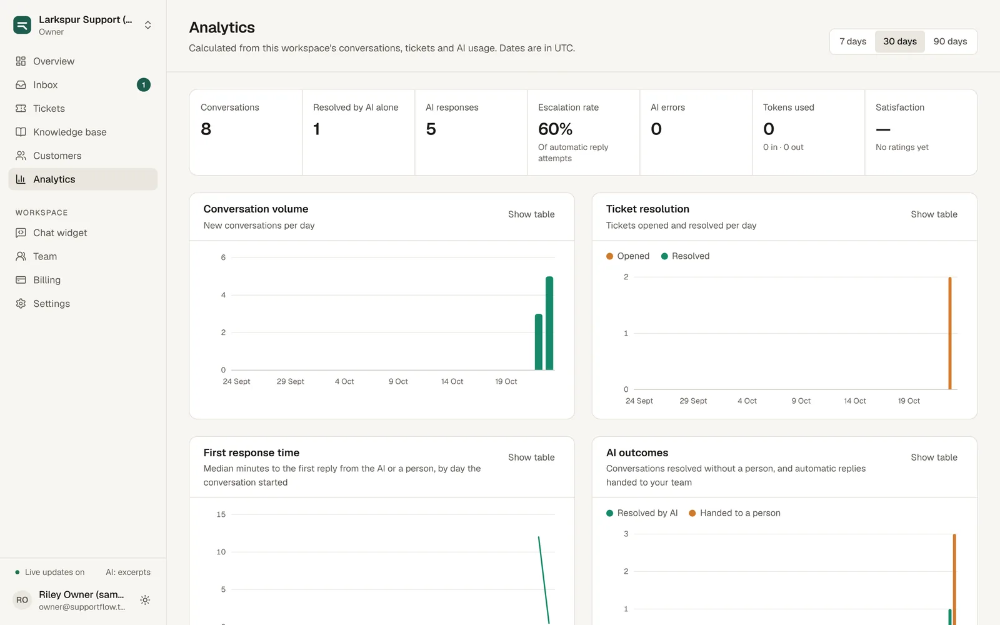
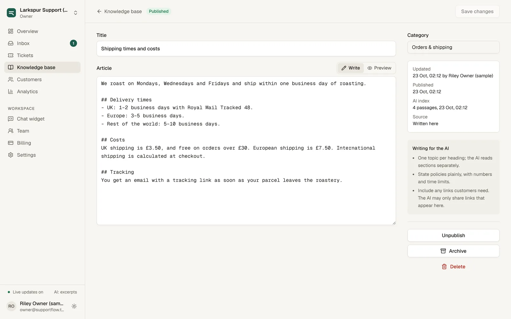
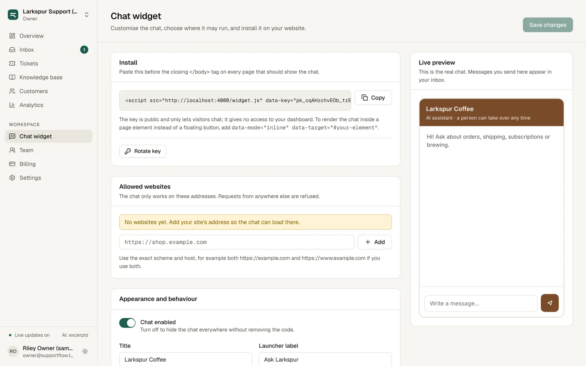
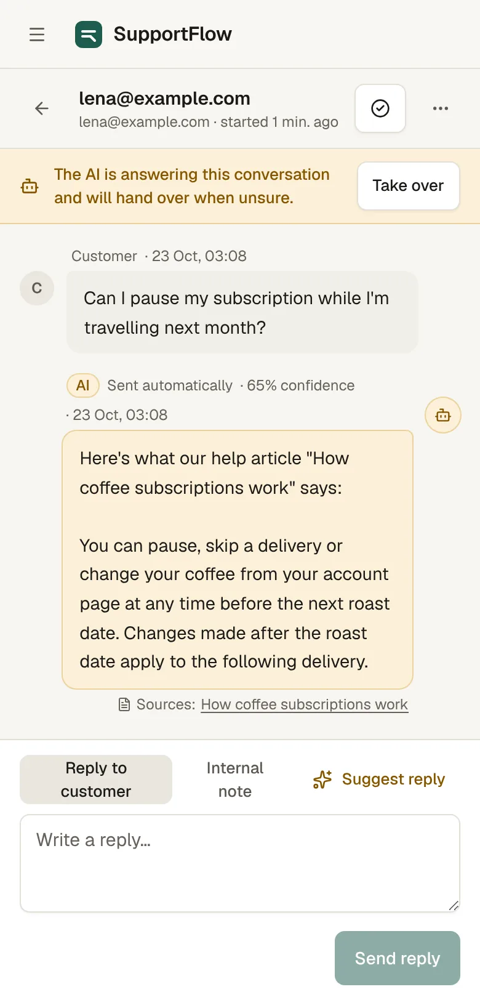

# SupportFlow AI — case study

**Role:** product design, full-stack engineering and AI integration (solo)  
**Stack:** Next.js 16, React 19, TypeScript, Tailwind CSS, Fastify 5, PostgreSQL, Drizzle, WebSockets, Anthropic/OpenAI, Stripe  
**Status:** feature-complete and tested; not deployed yet ([deployment guide](DEPLOYMENT.md))



## The problem

Small support teams answer the same questions every day — shipping times, returns, subscriptions — while the conversations that need judgement (a double charge, an angry customer, a legal question) wait in the same queue. AI chatbots promise to help, but most either answer everything with false confidence or are so locked down they help no one. Teams also can't afford to let a bot promise a refund it can't give.

## The solution

SupportFlow is a shared inbox, help centre, ticketing system and website chat in one product, with an AI assistant on a short leash:

- It answers **only from the business's published help articles** and shows which ones it used.
- It replies on its own **only above a confidence threshold the team sets**; otherwise it saves a draft and hands the conversation to a person.
- **Refunds, billing, account changes and legal topics always go to a person**, enforced in code rather than by asking the model nicely.
- Teams choose how much the AI does: off, suggestions on request, a draft for every reply that an agent approves, or automatic replies.
- Every AI message is labelled, for customers and for agents.



## Main features

- **Inbox** — live updates over WebSockets, views and search, unread state, assignment, internal notes, takeover, AI drafts (send, edit, discard), summaries.
- **Knowledge base** — Markdown articles, categories, drafts and publishing, import of existing docs, automatic re-indexing, and a tool that shows which passages the AI would read for a question.
- **Tickets** — per-workspace numbers, owners, priorities, statuses, comments and a change history.
- **Website chat** — one script tag, brand colour and copy, floating or inline, continuity across visits, "Talk to a person", optional email capture and a rating after resolution.
- **Analytics** — volume, first-response and resolution medians, AI outcomes, escalation rate, token usage, workload and satisfaction, calculated from the database with honest empty states.
- **Teams and billing** — owner/admin/agent roles, invitations, seat limits; Free, Starter, Pro and Business plans enforced by the API, with Stripe Checkout and verified webhooks.
- **Privacy** — minimal visitor data, per-customer deletion and automatic deletion of old conversations.







## Architecture

A Next.js web app on Vercel talks to a Fastify API through a same-origin proxy, so the session cookie stays first-party. The API owns PostgreSQL, the AI providers, Stripe, WebSockets and background jobs. The chat widget is a 20 KB Shadow DOM script served by the API.

```
Browser ─▶ Next.js (Vercel) ─/api proxy─▶ Fastify API (Render) ─▶ PostgreSQL (Neon)
Browser ─── WebSocket (single-use ticket) ─▶ Fastify API ─▶ Anthropic / OpenAI
Customer site ── widget.js + CORS + WebSocket ─▶ Fastify API ─▶ Stripe
```

Key decisions are explained in the [architecture document](ARCHITECTURE.md): why a separate API, why Postgres full-text search for retrieval, why guards live outside the model, and how tenant isolation works.

## Security considerations

- **Tenant isolation** on every query, verified by tests that try to read, change and delete another workspace's conversations, tickets, articles, customers and settings — all return 404.
- **Server-side sessions** (hashed tokens, httpOnly SameSite cookies), bcrypt passwords (hashed in Postgres), CSRF origin checks, rate limits.
- **Prompt-injection resistance:** untrusted text is escaped and wrapped as data; deterministic guards hold back replies that touch money or accounts, include unknown links or make promises; internal notes never reach the model.
- **Widget:** origin allow-list enforced from the browser's `Origin` header, public keys that can't open the dashboard, spam controls, and text-only rendering.
- **Billing:** the plan changes only on a signature-verified Stripe webhook; test billing is refused in production.

Full list: [security checklist](SECURITY.md).

## Quality

- 123 unit and integration tests: 105 API tests against a real PostgreSQL database (auth, tenant isolation, roles, AI failure handling, widget security, realtime, billing webhooks, analytics), plus widget and shared-package tests.
- 20 Playwright end-to-end tests, including a full journey from sign-up to an AI reply, a realtime handoff to an agent, a ticket and a customer rating, plus axe accessibility checks and phone-width layout checks.
- TypeScript strict mode and ESLint across the monorepo; the colour palette for charts was validated for colour-vision deficiency and contrast.

Testing caught real bugs before release: an AI reply that arrived before the widget's socket subscribed (now re-synced on connect), an inbox list that didn't update live because of how the data library treats paginated keys, and a stale signed-out session that bounced invited teammates back to the sign-in page.



## Deployment links

Not deployed yet. The production build, migrations and startup checks have been verified locally; deploying needs a Neon database, a Render service and a Vercel project (see [DEPLOYMENT.md](DEPLOYMENT.md)).

*Screenshots show a development workspace with sample conversations created through the real chat widget. The demo business, Larkspur Coffee Roasters, is fictional. Without an AI key configured, replies are excerpts from the help centre ("Here's what our help article says…").*
